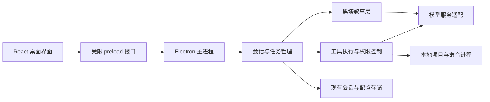

# 桌面实施总方案

> 当前状态（2026-10-07）：产品已迭代至0.8.4。下文早期轮次状态保留为历史；整体需求核对、证据范围及后续优先级见 [完整目标核对](COMPLETION_AUDIT.md)。

日期：2026-10-03。状态：设计提案，未实现。本文中的“要求”“应”是后续验收目标，不代表已经具备这些能力。

## 1. 产品边界

做一款能实际辅助本地编程的 Windows 桌面应用：用户选择项目，向大黑塔提出任务，观察执行过程、审阅变更、决定需要确认的操作，退出后仍能找回会话。角色感由措辞、色彩、少量图形体现，不妨碍阅读与工作。

“类 Codex”在本项目中指项目与会话组织、流式对话、工具活动、停止执行、文件与差异审阅、权限确认及桌面操作体验。不承诺任何商业产品全部功能或其账户服务；后续实现模型的名称不等于应用内使用的模型。

首个完成版必须具备：

- 可安装、可离线启动界面的 Windows x64 应用；真实推理需要用户配置可用服务。
- 打开本地项目、新建/恢复/重命名会话；明确当前操作目录。
- 真实流式回复、工具读写文件与运行命令、可展开的执行记录、停止与错误恢复。
- 查看文件和 Git 工作区差异；在权限策略需要时显示具体操作并确认或拒绝。
- 本地持久化、受保护的密钥、中文界面、简约大黑塔主题。

首版必须支持用户管理多个 Provider，自定义名称、API 协议、Base URL、API Key 和模型。OpenAI 与 Anthropic 两种 API 形式都是必需能力，DeepSeek 只是可选配置，不是应用运行前提。详细契约见 [Provider 接入规范](PROVIDERS.md)。

延后：跨机器同步、多人协作、自动提交与上传、自动更新服务、其他专有供应商协议、插件市场、语音、3D场景、动态立绘、自动入梦记忆。可以保留上游实现，但不让这些功能成为首版构建或使用的必要条件。

## 2. 上游核查与复用决策

检查来源：[PersonaCLI/Herta](https://github.com/PersonaCLI/Herta)。本次观察到 main 的提交为 `8fb809934e0807ee0f0f590d87365a83bb720ca2`。本地起点是仅有初始提交的空仓库，不能把上游文件当成本地已存在。

核查了 README、根 package.json、LICENSE、递归文件树、gui/package.json、renderer/ipc/bridge-types.ts 与 preload/index.ts。没有全面审计业务代码，也没有验证上游能在当前机器构建。

| 已观察的上游入口 | 用途与实施处理 |
| --- | --- |
| packages/gui | Electron + React + TypeScript；保留桌面主进程与受限 preload，重做主要布局 |
| packages/app-server | 会话、执行轮次、审批事件；核查后复用 |
| packages/core、packages/tools | Agent 工具循环、权限、文件和命令；优先保留现有行为与回归测试 |
| packages/herta | 角色叙事和执行器分离；角色显示名及提示材料需审查是否符合大黑塔方向 |
| packages/providers | 上游已有 DeepSeek 和兼容传输层；改为可配置 Provider 与独立协议适配器，新增 Anthropic 适配，解除 persona 对专用 completion 的依赖 |
| packages/memory、packages/knowledge | 延后扩展；不在第一轮改写存储机制 |
| website | 不是目标交付；暂时保留以避免破坏 workspace 引用 |

决策：优先从固定上游提交导入源码，在其基础上演进，不重新手写同等 Agent 引擎，不同时迁移 Tauri 和数据库；供应商协议解耦属于本次必要改造。导入步骤要记录来源 SHA、保留 LICENSE/THIRD-PARTY-NOTICES，保留当前 docs，不覆盖用户后续改动。先列冲突再做合并；不直接把带 .git 的另一个仓库覆盖到当前目录。

上游代码采用 MIT，但许可证明确把角色图像、人物资料和语音等排除在该代码授权之外。这里仅作为素材来源台账要求：记录每个实际采用的资源来源及适用范围，不阻碍个人项目开发；不能把代码许可证套用于全部美术。

源码入口（均固定到本次提交）：

- [README](https://github.com/PersonaCLI/Herta/blob/8fb809934e0807ee0f0f590d87365a83bb720ca2/README.md)
- [桌面依赖与脚本](https://github.com/PersonaCLI/Herta/blob/8fb809934e0807ee0f0f590d87365a83bb720ca2/packages/gui/package.json)
- [桌面接口类型](https://github.com/PersonaCLI/Herta/blob/8fb809934e0807ee0f0f590d87365a83bb720ca2/packages/gui/src/renderer/ipc/bridge-types.ts)
- [preload 桥接](https://github.com/PersonaCLI/Herta/blob/8fb809934e0807ee0f0f590d87365a83bb720ca2/packages/gui/src/preload/index.ts)
- [许可范围](https://github.com/PersonaCLI/Herta/blob/8fb809934e0807ee0f0f590d87365a83bb720ca2/LICENSE)

## 3. 环境与打包需要先解决的事实

上游 README 指定 Node 22 LTS 和 pnpm 9；采用其锁文件和 .node-version，不盲目升级全部依赖。README 提醒 Node 26 与 better-sqlite3 的兼容问题，因此根 package.json 较宽松的 engines 不能作为随意升级依据。

gui 的 dist 脚本包含语音载荷检查、原生 TTS 准备及校验；README 同时说明源码不含 data/voice。因而“源码能运行”不代表直接执行 dist 必然能产出安装包。

第一轮实施必须新增或调整一个明确的无语音个人构建模式：不下载语音、不包含 TTS 依赖路径的必需检查，仍保留 notices、核心构建、安装包检查。相关实现须先读 electron-builder 配置和上述脚本，不能简单删除所有打包验证。无素材时使用项目自制的简洁几何占位图标，绝不让构建依赖一个尚未提供的角色文件。

派生版必须有独立 appId、显示名称与 userData 目录，避免污染用户已有 Herta 安装和会话。关闭指向上游发布通道的自动更新；本项目不自动发布或上传。

## 4. 架构与边界

界面不直接访问 fs、shell、密钥或任意 IPC。保持 contextIsolation、禁用 nodeIntegration，保留可用 sandbox。主进程验证输入、会话归属与路径；渲染层只能请求明确允许的业务操作。Markdown/代码/工具输出全部视作数据，不允许其创建任意本地链接执行或远程脚本。

优先沿用现有 HertaBridge。已观察到 submitText、interrupt、listSessions、openSession、createSession、resolveApproval、pickWorkspace、readWorkspaceFile、readWorkspaceDiff、onRecord、onTurn、onAgent、onReset 等入口。后续开发必须读完整签名和实现再映射，不根据本文名称自行猜参数。

可新增 UI 层 adapter/view-model，把现有 record 与事件转换为会话、工具卡片、变更面板；不让各组件自行拼接执行状态。任何确需新增的桥接方法，先由接口负责人同时更新类型、channels、preload、主进程校验与 mock。

## 5. 状态、持久化与故障处理

建议界面任务状态：idle → submitting → running → awaiting-approval / stopping → completed / failed / cancelled。它是展示模型，应从真实事件映射，不能另立一套会导致与主进程矛盾的执行事实。

- 每个执行事件须可关联 session 与 turn；切换会话不能把上一轮输出写入另一会话。
- 同一会话首版只允许一个活动轮次；重复发送需要禁用或明确队列策略，默认不暗中并发。
- 恢复界面时请求权威快照并处理增量事件；使用现有序号/同步能力，若不够再设计补充协议和重复事件测试。
- 停止应中断请求和关联工具进程；Windows 子进程树清理单独测试。停止不会自动撤销已写入的文件，应准确展示保留的改动。
- 只保存经过确认的最终执行状态；程序崩溃后未完成轮次标为中断，不能伪造完成或自动重放有副作用命令。
- 密钥通过已有主进程 key-store 核查后保存；日志脱敏，界面仅拿到状态和遮罩。操作系统加密不可用时，明确失败或征得用户对替代存储方式的选择，不静默明文保存。
- 先保留上游会话存储格式；若新增索引，设计 schemaVersion、备份和失败回退，不以重写存储作为UI改版前提。

## 6. 执行、审批与差异审阅

权限由程序控制，角色措辞不能授予权限。工作区访问须处理绝对路径、..、大小写、盘符、junction/symlink；边界由真实解析结果判断，不能只比较字符串前缀。

审批卡片展示实际操作、工作目录、命令或文件修改范围、影响及确认范围。默认提供单次允许和拒绝；长期规则设置放在独立设置页面，不默认勾选。拒绝、取消和超时都应使等待状态结束；旧轮次审批不能应用到新任务。

区分两类差异：工具计划写入前的审批预览，以及已经写入的 Git 工作区差异。后者不是“批准才落盘”；文案不能误导。若用户希望所有写入先预览，需明确添加对应权限策略与执行前检查，而非只增加一个按钮。

首版差异面板只读审阅，含文件列表、增删行、空状态、大文件与二进制提示。用户已有未提交改动必须可见；不擅自 reset、checkout 或回滚整个文件。精确撤销属于后续任务，需要执行前快照/校验，不能通过简单 git restore 冒充。

命令输出面板首版展示真实执行日志及退出码，不承诺完整交互终端。PTY 终端、终端多标签是独立后续扩展。

## 7. 模型与角色

首版提供 OpenAI 协议（Responses 与 Chat Completions 两个显式模式）和 Anthropic Messages 协议。用户可以添加多个 Provider，分别配置 Base URL、API Key 与模型，使用官方服务或对应协议的兼容服务。具体模型名称不硬编码；支持获取模型列表和手动输入模型 ID，按能力与测试结果选择可用模型，不能把“出现在列表中”或“连接成功”视作工具能力已验证。

黑塔对话与编程执行分别绑定 Provider + 模型，默认共用一组配置，可在高级设置拆分。重构 persona 输入构建，使其能经标准消息接口运行；DeepSeek completion 仅作为可选旧适配器保留。完整配置结构、协议差异、模型发现、切换与迁移规则见 [PROVIDERS.md](PROVIDERS.md)。

人格层与编程执行器分离：大黑塔可简洁、笃定、有轻微戏谑，但错误、执行结果和审批必须清楚准确；不能用角色对白替代真实工具证据。大黑塔与人偶黑塔的素材和措辞不要混用。正式人设资料待审阅，先采用短且可维护的人设约束。

无 API key 可浏览界面、管理本地项目和查看已有记录；演示模式显式标记，不能将固定回复包装成真实推理。真实服务测试需要用户本地配置，不把密钥写入仓库或聊天交接文档。

## 8. 迭代节奏与交付

本次为规划轮。后续安排四个实施轮次：基础桌面与打包 → 工作台与视觉 → 真实编程闭环 → 故障、性能和安装验收。具体卡片见 TASKS.md。每轮提交可运行结果、测试证据、已知问题及下一轮建议，用户自行提交上传；助手不自动替用户推送。

优先级按：数据丢失/越权/无法启动 → 任务不能完成 → 状态错误 → 阅读与操作问题 → 装饰细节。每轮不因新美术想法扩大核心范围；新增事项进入 backlog。

四轮是基线而非强制结束。达到 ACCEPTANCE.md 的核心完成条件并经用户实际使用反馈后结束；若失败，只追加针对具体未达标项的修复轮，不无限重写。

## 9. 尚待确认但不阻碍起步的事项

- 具体大黑塔立绘/头像：到素材整合阶段展示已有素材候选，或请用户提供偏好的图；此前使用抽象图标。
- 最终应用名称：暂用 Herta Atelier 作派生版工作名，需实施时检查 appId 和名称冲突。
- 模型服务：两种 API 形式及自定义 Provider 已确定；具体服务地址、凭据和模型由用户本地配置。联网验收前核实账户可用性，不再将多 Provider 支持列为待确认或延期事项。
- Win10 是否必须支持：Windows 11 x64 为首个实测目标；声称支持 Win10 前必须在对应环境测试。

这些是待落实的产品选择，不代表需要在开始基础实现前逐项停工询问。

